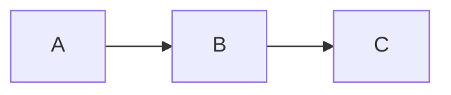

# 标题一 AAA

## 标题二 BBB

### 标题三 CCC

普通段落含 **加粗文字** 与 *斜体文字* 以及 SEARCHME 关键字用于搜索测试。

- 无序项 A
- 无序项 B
- 无序项 C

1. 有序第一
2. 有序第二
3. 有序第三

> 这是一段引用块内容

```js
const x = 42;
function hello(name) {
  return name;
}
```

```python
print("hello world")
```

```
纯文本代码块
第二行内容
```

| 列一 | 列二 | 列三 |
|-----|-----|-----|
| A1  | B1  | C1  |
| A2  | B2  | C2  |
| A3  | B3  | C3  |



- [ ] 待办未完成
- [x] 待办已完成

第二处出现 SEARCHME 搜索词这里。
